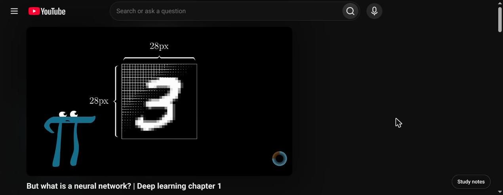
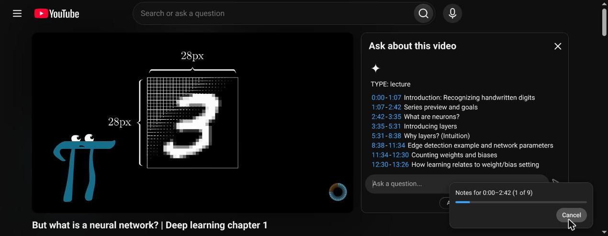
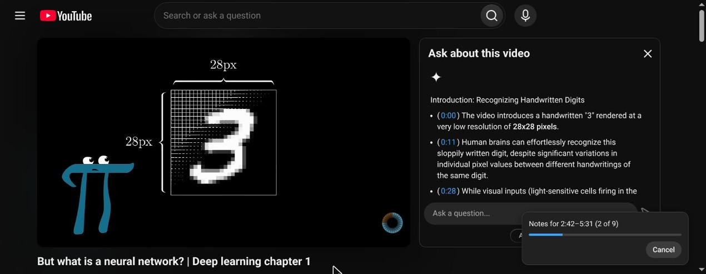
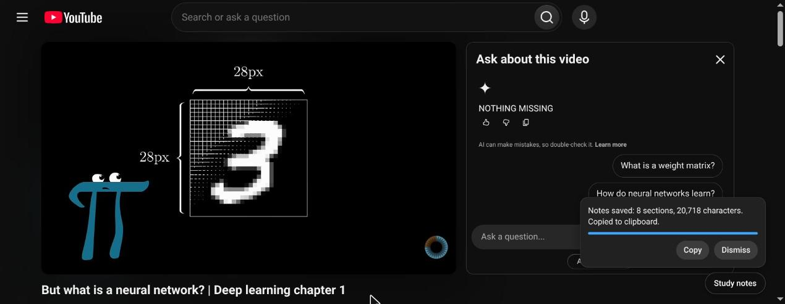
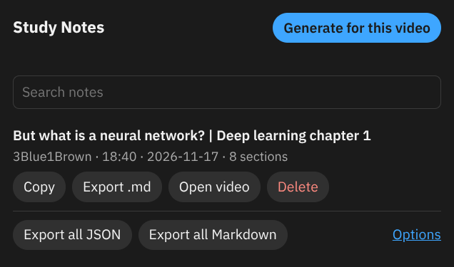
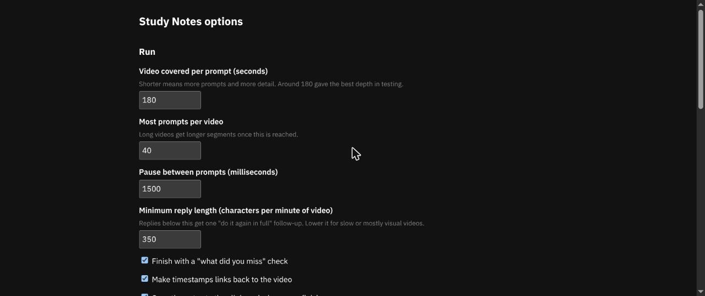

# YouTube Study Notes

> [!WARNING]
> **This project was vibe-coded.** It was written largely by an AI assistant with light human review and limited testing. It may contain bugs, break when YouTube changes its page, or behave in unexpected ways. It drives YouTube's UI automatically and stores data in your browser. Review the code before installing, and use it at your own risk.

A browser extension (Chromium and Firefox, Manifest V3) that turns a YouTube video into detailed, timestamped study notes. It drives YouTube's own **Ask** panel one section at a time, so the notes go deeper than a single summary prompt would.



## How it works

1. **Outline:** it asks for the video's type and a timestamped list of sections.
2. **Section notes:** it asks for full notes on each stretch of the video (about 3 minutes by default). If a reply is too short for the length of video it covers, it sends one "do it again in full" follow-up.
3. **Gap check** (optional): it asks what the notes missed.
4. **Stitch:** it combines the replies into one Markdown document, with timestamps that link back to the video. The document is saved to the library and copied to the clipboard.

| Outline pass | Section pass |
| --- | --- |
|  |  |



## Install

1. Open `chrome://extensions` and turn on **Developer mode**.
2. Click **Load unpacked** and select this folder.

In Firefox, use `about:debugging` → **Load Temporary Add-on** and pick `manifest.json`.

You need to be signed in to YouTube on a video that offers the Ask panel.

## Use

- Click **Study notes** in the bottom-right corner of a video page, or press **Alt+Shift+N**.
- Watch progress in the toast. You can cancel at any time and keep partial notes.
- Open the toolbar popup to search the library, copy a note, export one as `.md`, or export everything as JSON or combined Markdown.



## Options

Set the seconds covered per prompt, the maximum number of prompts, the pause between prompts, and the minimum reply length. Toggles turn the gap check, timestamp links, and auto-copy on or off. You can override any of the four prompt templates.



## Develop

```sh
npm test   # node --test; covers outline parsing, the pipeline, HTML→Markdown and export
```

The `src/lib/` modules don't touch the DOM and run under Node. The parts that depend on YouTube's page are in `src/content/`, and the DOM selectors are in `src/content/selectors.js`.
